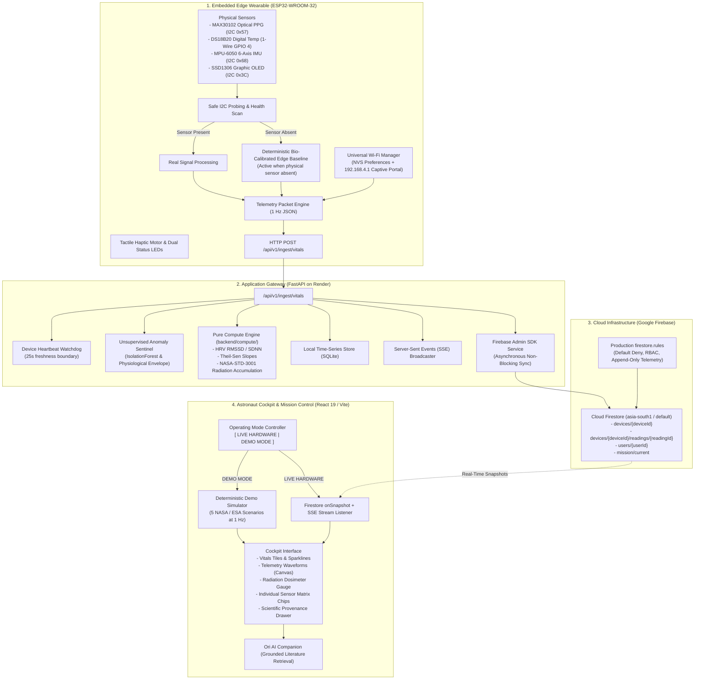

# AstroVitals System Architecture

Autonomous Clinical Decision Support and Physiological Health Guardian for Astronauts.
NASA Space Apps Challenge 2026 - Challenge 5: Health Monitoring Software for Astronauts.
Team Orbitrix, Dhaka, Bangladesh. Licensed under the Apache License 2.0.

---

## 1. Architectural Philosophy and Design Principles

Deep-space exploration missions to the Moon or Mars present unprecedented operational constraints:
- Up to 22 minutes of one-way communication latency between crew members and Earth ground control.
- Intermittent or total loss of signal (LOS) during orbital occultation, solar storms, or relay outages.
- High physical and psychological stressors across microgravity, ionizing cosmic radiation, and confined isolation.

AstroVitals solves deep-space medical autonomy using a layered spine pattern with two distinct operating models:
1. **Live Hardware Telemetry Mode**: Real-time biometric acquisition from the ESP32 wearable hub over 2.4 GHz Wi-Fi with sub-second ingestion, real-time Cloud Firestore synchronization, and two-way advisory ground actuation.
2. **Professional Demonstration Mode**: A deterministic, zero-hallucination scientific simulator reproducing five clinically grounded NASA and ESA spaceflight scenarios, enabling complete offline review and evaluation even when physical sensors or hardware are disconnected.

---

## 2. End-to-End System Architecture

---

## 3. Coexistence Model: Live Hardware and Demonstration Mode

A core requirement of AstroVitals is total resilience under all operating environments. The platform maintains two first-class modes that live side-by-side without interference:

| Architectural Property | Live Hardware Mode | Demonstration Mode |
|:---|:---|:---|
| **Primary Trigger** | Physical ESP32 connects over Wi-Fi | Mode toggle switch in top navigation bar |
| **Data Source** | Physical I2C sensor readings or calibrated edge baseline | 5 deterministic mathematical spaceflight scenarios |
| **Telemetry Transport** | Wi-Fi HTTP POST to FastAPI, Firebase Admin SDK to Firestore | Client-side reactive generator at 1 Hz with zero network latency |
| **Hardware Heartbeat** | Active 25-second freshness watchdog checks `last_seen` | Simulated nominal connectivity with test event simulation |
| **Sensor Availability** | Explicit per-sensor chip display (Connected vs Pending Install) | Complete simulated sensor suite mapped to scenario physiology |
| **Alert Generation** | Edge threshold breaches and ground command dispatches | Scenario-specific clinical alarms (e.g. Tachycardia, Hypercapnia) |
| **Scientific Citation** | Live device provenance metadata | Formal NASA OSDR and NASA-STD-3001 evidence citations |
| **Offline Reliability** | Requires local Wi-Fi router or ESP32 SoftAP hotspot | Fully operational with zero Wi-Fi, backend, or cloud connection |

---

## 4. The Layer Rule: Deterministic Science vs Generative AI

To ensure clinical trustworthiness, AstroVitals enforces a strict architectural boundary known as **The Layer Rule**:

> **The Model Never Computes Numbers Directly.**

1. **Deterministic Science Layer (`backend/compute/`)**:
   - Written exclusively as pure, tested Python functions with type hints.
   - Computes statistical deviations, z-scores, p-values, HRV RMSSD, SDNN, Theil-Sen non-parametric trend slopes, and cumulative radiation math.
   - Completely isolated from LLM prompts. Zero prompt hallucination risk.
2. **AI Companion Layer (Ori)**:
   - Uses plain state-machine orchestration with a hard 6-step iteration cap.
   - Formally retrieves peer-reviewed studies from NASA OSDR, NASA NTRS, and PubMed.
   - Explains medical implications, contextualizes deviations, and cites verified research.
   - Blocked by the Provenance Gate if any numeric claim lacks a valid dataset ID and source URL.

---

## 5. Security and Data Flow Boundaries

- **Client-Side Security**: React 19 single-page application never makes direct unauthenticated writes to Firestore.
- **Firebase Security Rules**: Authored under `firestore.rules` with default-deny semantics, astronaut-scoped read permissions, and immutable append-only telemetry subcollections.
- **Backend Secrets**: API credentials and service account certificates remain strictly in environment variables (`.env`). No secrets are committed to version control.

